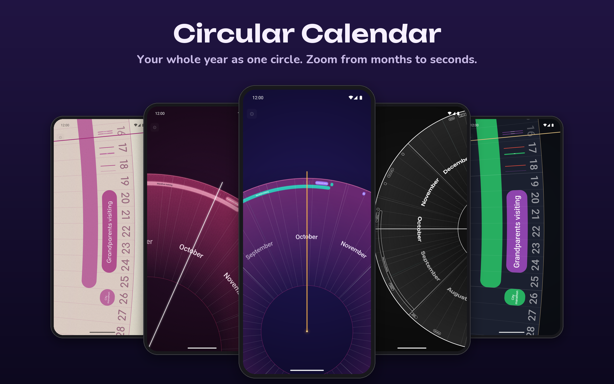
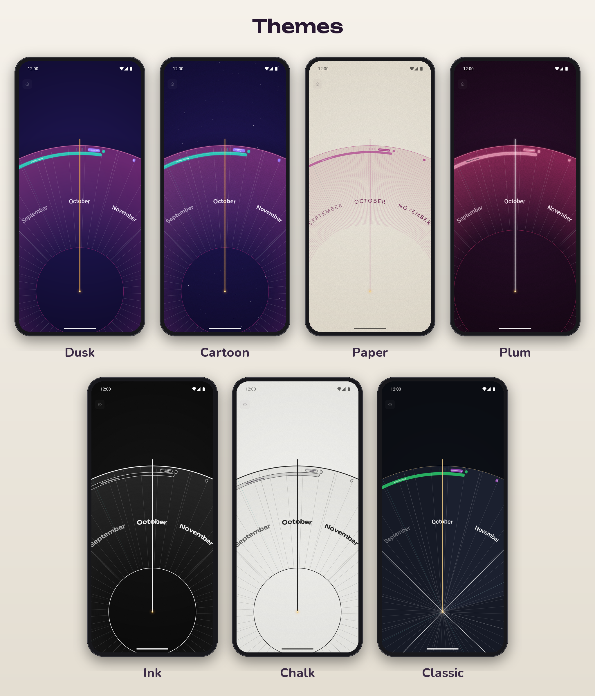
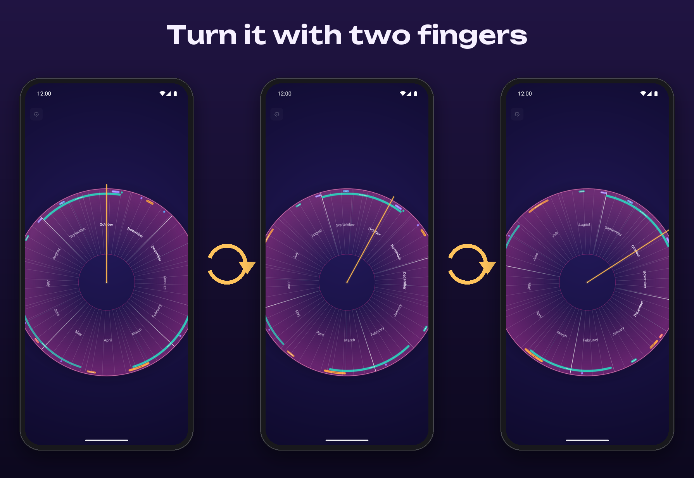
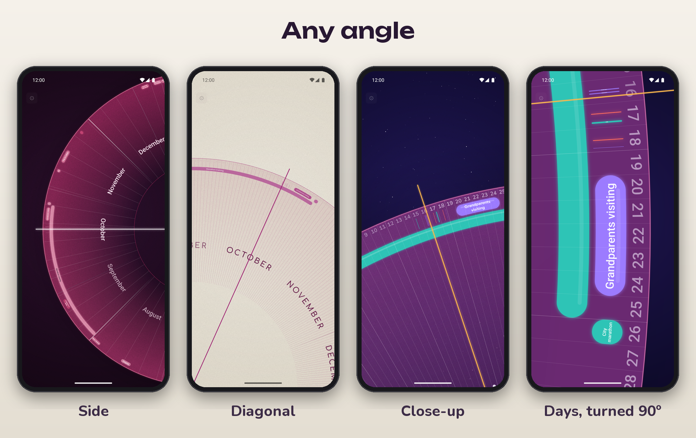
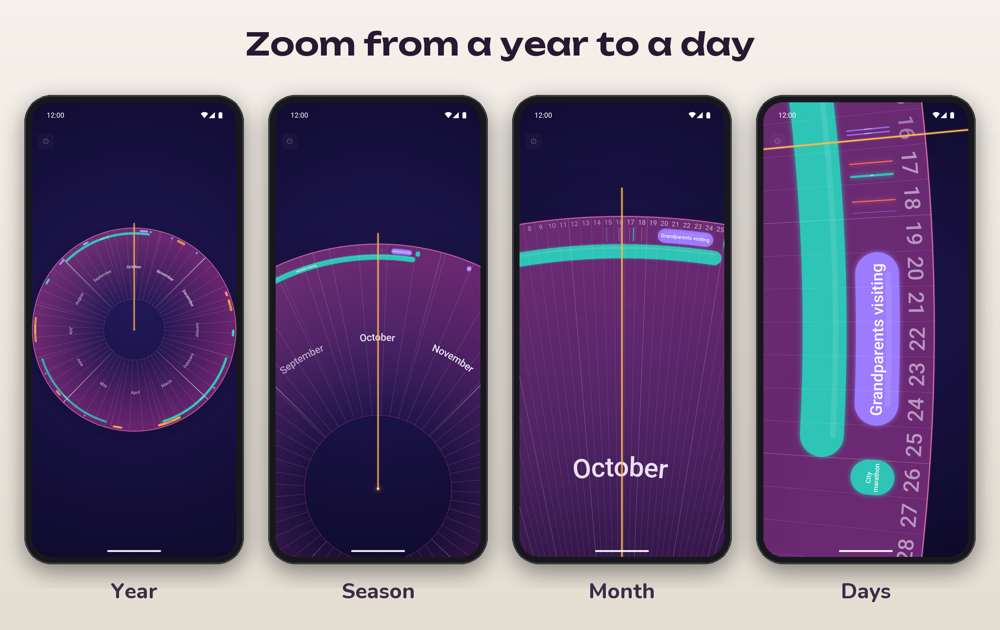

# Circular Calendar



A calendar for Android that shows your year as a circle.

Months and days go around the ring, clockwise. "Now" is at the top, marked by a
hand from the centre (you can switch to counter-clockwise or "now" at the bottom). Pinch to zoom from the whole year down to a single day,
hour or even second. Drag to move, twist with two fingers to rotate.
Your events from the phone's calendar are drawn on the ring.

## Features

- **The whole year at a glance** — six months back and six months ahead.
- **Smooth zoom** — from the year to seconds, the labels change as you zoom.
- **Your calendar** — reads events from the calendars on your phone (Google Calendar and others).
- **Seven themes** — Dusk, Cartoon, Paper, Plum, Ink, Chalk, Classic.
- **Home screen widget** — a slice of the circle: month, week or day.
- **Solar System to scale** — the Sun at the centre, the Earth at the tip of the hand.
- **Tiny and fast** — about 0.5 MB, no third-party libraries, made for 90–120 Hz screens.
- **13 languages.**

## Themes



## Rotate





## Zoom



## Install

Download the APK from [Releases](../../releases) and open it on your phone.
Android 10 or newer. The app asks for read access to your calendar; without it,
it shows a sample calendar.

## Build

Requirements: JDK 17, Android SDK 35.

```bash
./gradlew assembleRelease
```

The APK will be in `app/build/outputs/apk/release/`.

## Project

- Written in Kotlin, drawn with Android Canvas. No dependencies.
- [CHANGELOG.md](CHANGELOG.md) — what changed in each version.
- [docs/RELEASING.md](docs/RELEASING.md) — versioning and how releases are made.
- `tools/` — screenshots, mockups and render checks for the emulator.

## License

[GPL-3.0](LICENSE). Bundled fonts (Nunito, Comfortaa, Rubik, Unbounded) are under the
SIL Open Font License 1.1 — see [licenses/fonts](licenses/fonts).
